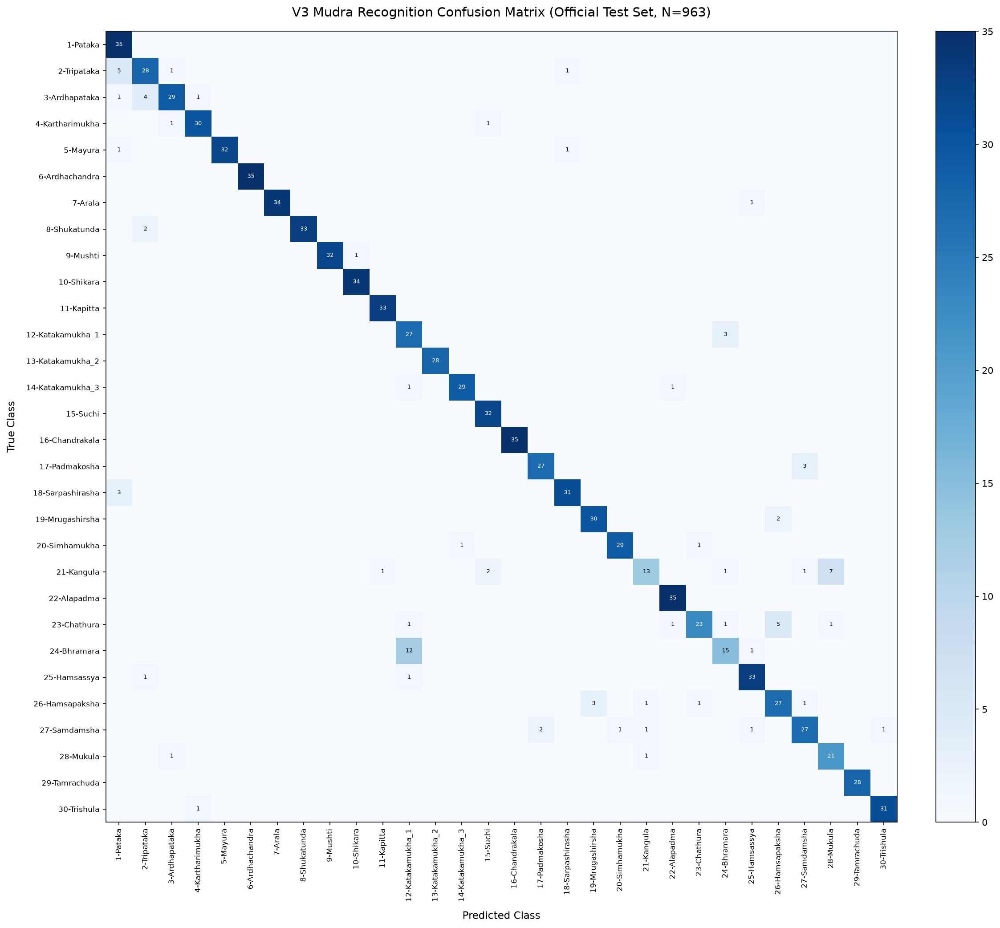

# Milestone V3: Experimental Model Retraining Summary

## 1. Executive Summary

Milestone V3 evaluated the integration of landmark features extracted via the two-stage detection cascade into the RBF SVM classifier.
The training dataset expanded from 2,181 samples (Baseline) and 12,280 samples (V2) to **13,416 samples across 30 classes**.

## 2. Benchmark Test Set Evaluation

| Model Variant | Conditional Acc (%) | End-to-End Acc (%) | Macro F1 | Weighted F1 | Macro Precision | Macro Recall | Inference Speed |
|:---|:---:|:---:|:---:|:---:|:---:|:---:|:---:|
| **Original Baseline** | **91.48%** | **83.90%** | **0.9137** | — | 0.9234 | 0.9148 | — |
| **V2 (Augmented)** | 89.82% | 82.38% | 0.8915 | 0.8974 | 0.8979 | 0.8919 | — |
| **V3 Balanced SVM** | 89.82% | 82.38% | 0.8917 | 0.8973 | 0.8976 | 0.8924 | 2473.0 FPS |
| **V3 Unweighted SVM** | **90.97%** | **83.43%** | **0.9037** | **0.9083** | **0.9103** | **0.9049** | **2829.9 FPS** |

## 3. Per-Class F1 Score Comparison

| Mudra Class | Test Support | Baseline F1 | V2 F1 | V3 F1 | Delta vs Baseline | Delta vs V2 |
|:---|:---:|:---:|:---:|:---:|:---:|:---:|
| `1-Pataka` | 35 | 0.8861 | 0.8861 | **0.8750** | **-0.0111** | **-0.0111** |
| `2-Tripataka` | 35 | 0.8615 | 0.7887 | **0.8000** | **-0.0615** | **+0.0113** |
| `3-Ardhapataka` | 35 | 0.9589 | 0.8615 | **0.8657** | **-0.0932** | **+0.0042** |
| `4-Kartharimukha` | 32 | 0.9524 | 0.9206 | **0.9375** | **-0.0149** | **+0.0169** |
| `5-Mayura` | 34 | 0.9851 | 0.9538 | **0.9697** | **-0.0154** | **+0.0159** |
| `6-Ardhachandra` | 35 | 1.0000 | 0.9859 | **1.0000** | **+0.0000** | **+0.0141** |
| `7-Arala` | 35 | 0.9855 | 0.9706 | **0.9855** | **+0.0000** | **+0.0149** |
| `8-Shukatunda` | 35 | 0.9565 | 0.9706 | **0.9706** | **+0.0141** | **-0.0000** |
| `9-Mushti` | 33 | 0.9846 | 0.9846 | **0.9846** | **+0.0000** | **+0.0000** |
| `10-Shikara` | 34 | 0.9855 | 0.9855 | **0.9855** | **+0.0000** | **+0.0000** |
| `11-Kapitta` | 33 | 1.0000 | 0.9851 | **0.9851** | **-0.0149** | **-0.0000** |
| `12-Katakamukha_1` | 30 | 0.7353 | 0.7042 | **0.7500** | **+0.0147** | **+0.0458** |
| `13-Katakamukha_2` | 28 | 1.0000 | 1.0000 | **1.0000** | **+0.0000** | **+0.0000** |
| `14-Katakamukha_3` | 31 | 0.9333 | 0.9508 | **0.9508** | **+0.0175** | **+0.0000** |
| `15-Suchi` | 32 | 0.9846 | 0.9412 | **0.9552** | **-0.0294** | **+0.0140** |
| `16-Chandrakala` | 35 | 1.0000 | 1.0000 | **1.0000** | **+0.0000** | **+0.0000** |
| `17-Padmakosha` | 30 | 0.8929 | 0.8148 | **0.9153** | **+0.0224** | **+0.1005** |
| `18-Sarpashirasha` | 34 | 0.9538 | 0.9118 | **0.9254** | **-0.0284** | **+0.0136** |
| `19-Mrugashirsha` | 32 | 0.9062 | 0.9231 | **0.9231** | **+0.0169** | **-0.0000** |
| `20-Simhamukha` | 31 | 0.9677 | 0.9836 | **0.9508** | **-0.0169** | **-0.0328** |
| `21-Kangula` | 25 | 0.6667 | 0.5714 | **0.6341** | **-0.0326** | **+0.0627** |
| `22-Alapadma` | 35 | 0.9859 | 0.9859 | **0.9722** | **-0.0137** | **-0.0137** |
| `23-Chathura` | 32 | 0.8197 | 0.8475 | **0.8070** | **-0.0127** | **-0.0405** |
| `24-Bhramara` | 28 | 0.6275 | 0.5600 | **0.6250** | **-0.0025** | **+0.0650** |
| `25-Hamsassya` | 35 | 0.9577 | 0.9296 | **0.9296** | **-0.0281** | **-0.0000** |
| `26-Hamsapaksha` | 33 | 0.7692 | 0.8182 | **0.8060** | **+0.0368** | **-0.0122** |
| `27-Samdamsha` | 33 | 0.7945 | 0.7671 | **0.8308** | **+0.0363** | **+0.0637** |
| `28-Mukula` | 23 | 0.7755 | 0.7600 | **0.8077** | **+0.0322** | **+0.0477** |
| `29-Tamrachuda` | 28 | 1.0000 | 1.0000 | **1.0000** | **+0.0000** | **+0.0000** |
| `30-Trishula` | 32 | 0.9524 | 0.9841 | **0.9688** | **+0.0163** | **-0.0153** |

## 4. Confusion Matrix

*Report generated automatically by `src/train_v3_model.py`.*