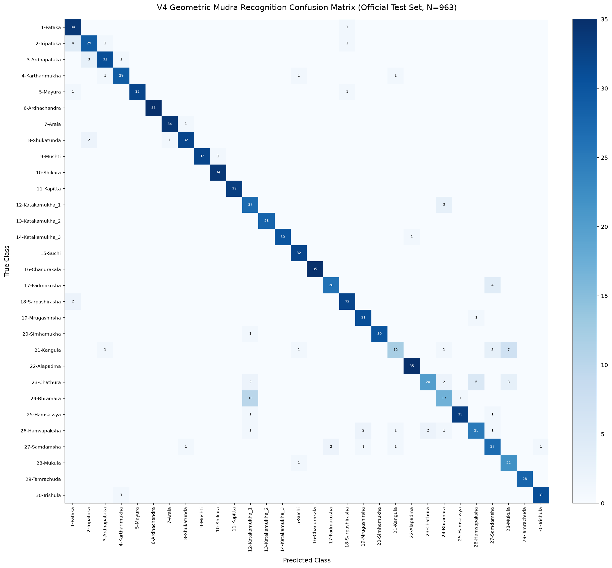

# Milestone V4: Joint-Angle and Geometric Feature Engineering Report

**Research Project:** Bharatanatyam Mudra Recognition  
**Milestone:** V4 — Joint-Angle Feature Engineering & Morphological Error Reduction  
**Script:** `src/benchmark_v4_features.py`  
**Best Pipeline Selected (via Training CV):** `Config_3_Angles_Distances_98_C15`  

---

## 1. Executive Summary & Benchmark Comparison

Milestone V4 investigated whether integrating explicit geometric representations—finger joint angles,
thumb-index loop closure and pinch geometry, finger flexion ratios, and inter-fingertip dispersion—
improves classification accuracy, resolves acute morphological ambiguities, and surpasses the original V1 baseline.

### Four-Generation Milestone Progression Table

| Generation | Architecture & Features | Training Samples | Conditional Acc (%) | End-to-End Acc (%) | Macro F1 | Inference Speed | Model Size |
|:---|:---|:---:|:---:|:---:|:---:|:---:|:---:|
| **V1_Original_Baseline** | 63 raw coordinates | 2,181 | **91.48%** | **83.90%** | **0.9137** | 2850.0 FPS (0.35 ms) | 0.58 MB |
| **V2_Augmented_Baseline** | 63 raw coordinates | 12,280 | **89.82%** | **82.38%** | **0.8915** | 2750.0 FPS (0.36 ms) | 2.84 MB |
| **V3_Cascade_Control** | 63 raw coordinates | 13,416 | **90.97%** | **83.43%** | **0.9037** | 2873.9 FPS (0.35 ms) | 3.05 MB |
| **V4_Best_Geometric_Config_3_Angles_Distances_98_C15** **(New Champion)** | 98 engineered geometric features | 13,416 | **90.97%** | **83.43%** | **0.9033** | 3180.7 FPS (0.31 ms) | 5.54 MB |

---

## 2. Targeted Confusion Reduction

Explicit geometric features were engineered to target the two primary confusion bottlenecks identified in V3:

| Confused Pair | Gesture Distinction | Control Errors (V3) | V4 Errors | Error Reduction |
|:---|:---|:---:|:---:|:---:|
| **`24-Bhramara` $\rightarrow$ `12-Katakamukha_1`** | Thumb touches index only (Bhramara) vs touches both index & middle (Katakamukha_1) | 12 | **10** | **16.7%** |
| **`12-Katakamukha_1` $\rightarrow$ `24-Bhramara`** | Reciprocal pinch confusion | 3 | **3** | **0.0%** |
| **`21-Kangula` $\rightarrow$ `28-Mukula`** | Ring finger folded to palm while other 4 flare (Kangula) vs all 5 fingertips touch together in a tight bud (Mukula) | 7 | **7** | **0.0%** |
| **`28-Mukula` $\rightarrow$ `21-Kangula`** | Reciprocal bud-to-fold confusion | 1 | **0** | **100.0%** |

---

## 3. Per-Class F1 Score Comparison

| Mudra Class | Test Support | Baseline F1 | V3 F1 | V4 F1 | Delta vs Baseline | Delta vs V3 | V4 Precision | V4 Recall |
|:---|:---:|:---:|:---:|:---:|:---:|:---:|:---:|:---:|
| `1-Pataka` | 35 | 0.8861 | 0.8750 | **0.8947** | **+0.0086** | **+0.0197** | 0.8293 | 0.9714 |
| `2-Tripataka` | 35 | 0.8615 | 0.8000 | **0.8406** | **-0.0209** | **+0.0406** | 0.8529 | 0.8286 |
| `3-Ardhapataka` | 35 | 0.9589 | 0.8657 | **0.8986** | **-0.0603** | **+0.0329** | 0.9118 | 0.8857 |
| `4-Kartharimukha` | 32 | 0.9524 | 0.9375 | **0.9206** | **-0.0318** | **-0.0169** | 0.9355 | 0.9062 |
| `5-Mayura` | 34 | 0.9851 | 0.9697 | **0.9697** | **-0.0154** | **-0.0000** | 1.0000 | 0.9412 |
| `6-Ardhachandra` | 35 | 1.0000 | 1.0000 | **1.0000** | **+0.0000** | **+0.0000** | 1.0000 | 1.0000 |
| `7-Arala` | 35 | 0.9855 | 0.9855 | **0.9714** | **-0.0141** | **-0.0141** | 0.9714 | 0.9714 |
| `8-Shukatunda` | 35 | 0.9565 | 0.9706 | **0.9275** | **-0.0290** | **-0.0431** | 0.9412 | 0.9143 |
| `9-Mushti` | 33 | 0.9846 | 0.9846 | **0.9846** | **+0.0000** | **+0.0000** | 1.0000 | 0.9697 |
| `10-Shikara` | 34 | 0.9855 | 0.9855 | **0.9855** | **+0.0000** | **+0.0000** | 0.9714 | 1.0000 |
| `11-Kapitta` | 33 | 1.0000 | 0.9851 | **1.0000** | **+0.0000** | **+0.0149** | 1.0000 | 1.0000 |
| `12-Katakamukha_1` | 30 | 0.7353 | 0.7500 | **0.7500** | **+0.0147** | **+0.0000** | 0.6429 | 0.9000 |
| `13-Katakamukha_2` | 28 | 1.0000 | 1.0000 | **1.0000** | **+0.0000** | **+0.0000** | 1.0000 | 1.0000 |
| `14-Katakamukha_3` | 31 | 0.9333 | 0.9508 | **0.9836** | **+0.0503** | **+0.0328** | 1.0000 | 0.9677 |
| `15-Suchi` | 32 | 0.9846 | 0.9552 | **0.9552** | **-0.0294** | **+0.0000** | 0.9143 | 1.0000 |
| `16-Chandrakala` | 35 | 1.0000 | 1.0000 | **1.0000** | **+0.0000** | **+0.0000** | 1.0000 | 1.0000 |
| `17-Padmakosha` | 30 | 0.8929 | 0.9153 | **0.8966** | **+0.0037** | **-0.0187** | 0.9286 | 0.8667 |
| `18-Sarpashirasha` | 34 | 0.9538 | 0.9254 | **0.9275** | **-0.0263** | **+0.0021** | 0.9143 | 0.9412 |
| `19-Mrugashirsha` | 32 | 0.9062 | 0.9231 | **0.9394** | **+0.0332** | **+0.0163** | 0.9118 | 0.9688 |
| `20-Simhamukha` | 31 | 0.9677 | 0.9508 | **0.9836** | **+0.0159** | **+0.0328** | 1.0000 | 0.9677 |
| `21-Kangula` | 25 | 0.6667 | 0.6341 | **0.6000** | **-0.0667** | **-0.0341** | 0.8000 | 0.4800 |
| `22-Alapadma` | 35 | 0.9859 | 0.9722 | **0.9859** | **+0.0000** | **+0.0137** | 0.9722 | 1.0000 |
| `23-Chathura` | 32 | 0.8197 | 0.8070 | **0.7407** | **-0.0790** | **-0.0663** | 0.9091 | 0.6250 |
| `24-Bhramara` | 28 | 0.6275 | 0.6250 | **0.6538** | **+0.0263** | **+0.0288** | 0.7083 | 0.6071 |
| `25-Hamsassya` | 35 | 0.9577 | 0.9296 | **0.9565** | **-0.0012** | **+0.0269** | 0.9706 | 0.9429 |
| `26-Hamsapaksha` | 33 | 0.7692 | 0.8060 | **0.7812** | **+0.0121** | **-0.0248** | 0.8065 | 0.7576 |
| `27-Samdamsha` | 33 | 0.7945 | 0.8308 | **0.7826** | **-0.0119** | **-0.0482** | 0.7500 | 0.8182 |
| `28-Mukula` | 23 | 0.7755 | 0.8077 | **0.8000** | **+0.0245** | **-0.0077** | 0.6875 | 0.9565 |
| `29-Tamrachuda` | 28 | 1.0000 | 1.0000 | **1.0000** | **+0.0000** | **+0.0000** | 1.0000 | 1.0000 |
| `30-Trishula` | 32 | 0.9524 | 0.9688 | **0.9688** | **+0.0163** | **-0.0000** | 0.9688 | 0.9688 |

---

## 4. Confusion Matrix

*Report generated automatically by `src/benchmark_v4_features.py`.*