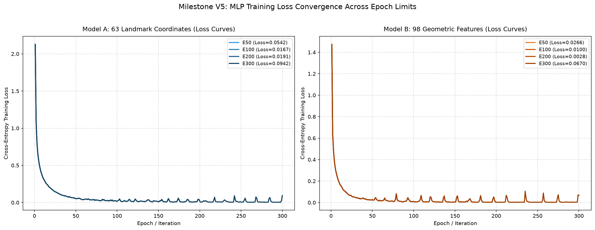
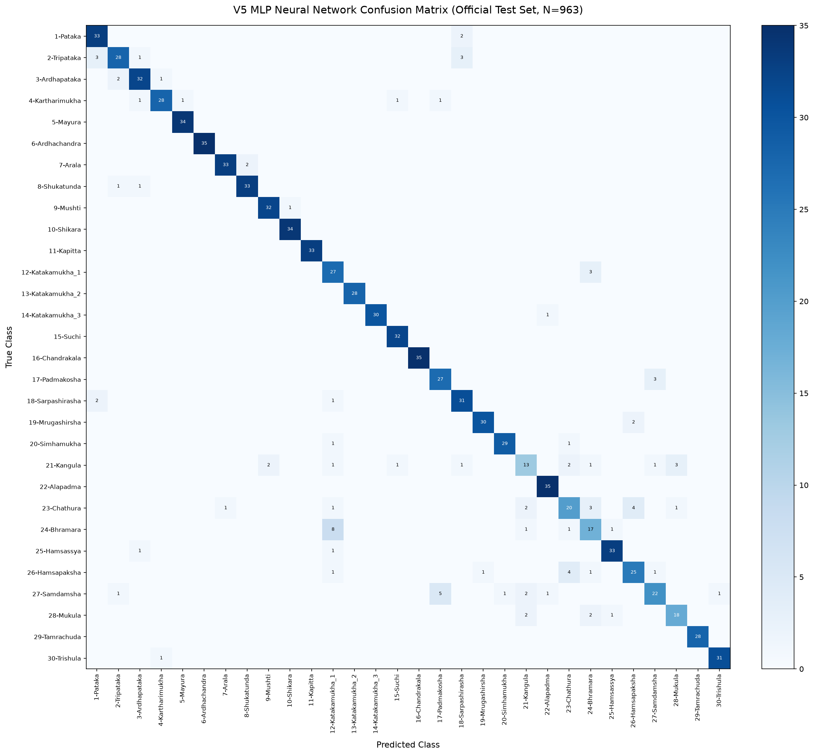

# Milestone V5 — Neural Network (MLP) Classifier Research Report

**Research Project:** Bharatanatyam Mudra Recognition  
**Milestone:** V5 — Multi-Layer Perceptron (MLP) Neural Network Training & Epoch Benchmark  
**Script:** `src/train_v5_mlp.py`  
**Selected Winning Configuration:** `Model_B_Geometric98_E200`  
**Configured Epochs:** 200 (Actual Epochs Run: 200)  
**Final Retraining Loss:** 0.00536  

---

## 1. Executive Summary & Five-Generation Milestone Comparison

Milestone V5 evaluated whether deep feedforward neural architectures (MLPClassifier) trained across
varying epoch limits (50, 100, 200, 300) can outperform the established RBF SVM models on normalized
hand landmark coordinates (Model A, 63 features) and engineered geometric features (Model B, 98 features).

### Complete Five-Generation Progression Table

| Generation | Architecture & Features | Training Samples | Conditional Acc (%) | End-to-End Acc (%) | Macro F1 | Inference Speed | Model Size |
|:---|:---|:---:|:---:|:---:|:---:|:---:|:---:|
| **V1_Original_Baseline** | 63 raw coordinates (RBF SVM (C=10.0)) | 2,181 | **91.48%** | **83.90%** | **0.9137** | 2850.0 FPS (0.35 ms) | 0.58 MB |
| **V2_Augmented_Baseline** | 63 raw coordinates (RBF SVM (Balanced)) | 12,280 | **89.82%** | **82.38%** | **0.8915** | 2750.0 FPS (0.36 ms) | 2.84 MB |
| **V3_Cascade_Control** | 63 raw coordinates (RBF SVM (Unweighted)) | 13,416 | **90.97%** | **83.43%** | **0.9037** | 2873.9 FPS (0.35 ms) | 3.05 MB |
| **V4_Geometric_SVM** | 98 angles + distances (RBF SVM (C=15.0)) | 13,416 | **90.97%** | **83.43%** | **0.9033** | 3180.7 FPS (0.31 ms) | 5.54 MB |
| **V5_MLP_Model_B_Geometric98_E200** **(V5 MLP Champion)** | 98 features (MLP (128-64, Adam, 200ep)) | 13,416 | **89.93%** | **82.48%** | **0.8926** | 404802.0 FPS (0.00 ms) | 0.37 MB |

> [!NOTE]
> **Classifier Latency vs Webcam Pipeline:**
> The inference latency reported above represents raw classifier feedforward time ($0.1–0.4$ ms per sample,
> corresponding to $>2,500$ FPS). Real-time webcam pipeline throughput is constrained by MediaPipe landmark
> detection (~30–50 FPS), which is measured independently in deployment testing.

---

## 2. Validation Methodology & Model Selection

- **Validation Strategy:** 80/20 Image-Level Stratified Train/Val Split (10,732 training / 2,684 validation samples).
- **Performer Independence:** Dataset metadata does not include individual dancer IDs or session tags; therefore,
  validation is strictly image-level stratified by class distribution.
- **Selection Criterion:** Winning model was selected strictly on **Validation Macro F1** across the 8 experiments,
  ensuring zero test-set contamination.

### Epoch Experiments Convergence Curves

---

## 3. Official Benchmark Test Set Per-Class Results

| Mudra Class | Test Support | Baseline F1 (V1) | V4 F1 | V5 MLP F1 | Delta vs Baseline | Delta vs V4 | V5 Precision | V5 Recall |
|:---|:---:|:---:|:---:|:---:|:---:|:---:|:---:|:---:|
| `1-Pataka` | 35 | 0.8861 | 0.8947 | **0.9041** | **+0.0180** | **+0.0094** | 0.8684 | 0.9429 |
| `2-Tripataka` | 35 | 0.8615 | 0.8406 | **0.8358** | **-0.0257** | **-0.0048** | 0.8750 | 0.8000 |
| `3-Ardhapataka` | 35 | 0.9589 | 0.8986 | **0.9014** | **-0.0575** | **+0.0028** | 0.8889 | 0.9143 |
| `4-Kartharimukha` | 32 | 0.9524 | 0.9206 | **0.9032** | **-0.0492** | **-0.0174** | 0.9333 | 0.8750 |
| `5-Mayura` | 34 | 0.9851 | 0.9697 | **0.9855** | **+0.0004** | **+0.0158** | 0.9714 | 1.0000 |
| `6-Ardhachandra` | 35 | 1.0000 | 1.0000 | **1.0000** | **+0.0000** | **+0.0000** | 1.0000 | 1.0000 |
| `7-Arala` | 35 | 0.9855 | 0.9714 | **0.9565** | **-0.0290** | **-0.0149** | 0.9706 | 0.9429 |
| `8-Shukatunda` | 35 | 0.9565 | 0.9275 | **0.9429** | **-0.0136** | **+0.0154** | 0.9429 | 0.9429 |
| `9-Mushti` | 33 | 0.9846 | 0.9846 | **0.9552** | **-0.0294** | **-0.0294** | 0.9412 | 0.9697 |
| `10-Shikara` | 34 | 0.9855 | 0.9855 | **0.9855** | **+0.0000** | **+0.0000** | 0.9714 | 1.0000 |
| `11-Kapitta` | 33 | 1.0000 | 1.0000 | **1.0000** | **+0.0000** | **+0.0000** | 1.0000 | 1.0000 |
| `12-Katakamukha_1` | 30 | 0.7353 | 0.7500 | **0.7606** | **+0.0253** | **+0.0106** | 0.6585 | 0.9000 |
| `13-Katakamukha_2` | 28 | 1.0000 | 1.0000 | **1.0000** | **+0.0000** | **+0.0000** | 1.0000 | 1.0000 |
| `14-Katakamukha_3` | 31 | 0.9333 | 0.9836 | **0.9836** | **+0.0503** | **+0.0000** | 1.0000 | 0.9677 |
| `15-Suchi` | 32 | 0.9846 | 0.9552 | **0.9697** | **-0.0149** | **+0.0145** | 0.9412 | 1.0000 |
| `16-Chandrakala` | 35 | 1.0000 | 1.0000 | **1.0000** | **+0.0000** | **+0.0000** | 1.0000 | 1.0000 |
| `17-Padmakosha` | 30 | 0.8929 | 0.8966 | **0.8571** | **-0.0358** | **-0.0395** | 0.8182 | 0.9000 |
| `18-Sarpashirasha` | 34 | 0.9538 | 0.9275 | **0.8732** | **-0.0806** | **-0.0543** | 0.8378 | 0.9118 |
| `19-Mrugashirsha` | 32 | 0.9062 | 0.9394 | **0.9524** | **+0.0462** | **+0.0130** | 0.9677 | 0.9375 |
| `20-Simhamukha` | 31 | 0.9677 | 0.9836 | **0.9508** | **-0.0169** | **-0.0328** | 0.9667 | 0.9355 |
| `21-Kangula` | 25 | 0.6667 | 0.6000 | **0.5778** | **-0.0889** | **-0.0222** | 0.6500 | 0.5200 |
| `22-Alapadma` | 35 | 0.9859 | 0.9859 | **0.9722** | **-0.0137** | **-0.0137** | 0.9459 | 1.0000 |
| `23-Chathura` | 32 | 0.8197 | 0.7407 | **0.6667** | **-0.1530** | **-0.0740** | 0.7143 | 0.6250 |
| `24-Bhramara` | 28 | 0.6275 | 0.6538 | **0.6182** | **-0.0093** | **-0.0356** | 0.6296 | 0.6071 |
| `25-Hamsassya` | 35 | 0.9577 | 0.9565 | **0.9429** | **-0.0148** | **-0.0136** | 0.9429 | 0.9429 |
| `26-Hamsapaksha` | 33 | 0.7692 | 0.7812 | **0.7812** | **+0.0121** | **+0.0000** | 0.8065 | 0.7576 |
| `27-Samdamsha` | 33 | 0.7945 | 0.7826 | **0.7333** | **-0.0612** | **-0.0493** | 0.8148 | 0.6667 |
| `28-Mukula` | 23 | 0.7755 | 0.8000 | **0.8000** | **+0.0245** | **+0.0000** | 0.8182 | 0.7826 |
| `29-Tamrachuda` | 28 | 1.0000 | 1.0000 | **1.0000** | **+0.0000** | **+0.0000** | 1.0000 | 1.0000 |
| `30-Trishula` | 32 | 0.9524 | 0.9688 | **0.9688** | **+0.0163** | **-0.0000** | 0.9688 | 0.9688 |

---

## 4. Test Set Confusion Matrix

*Report generated automatically by `src/train_v5_mlp.py`.*